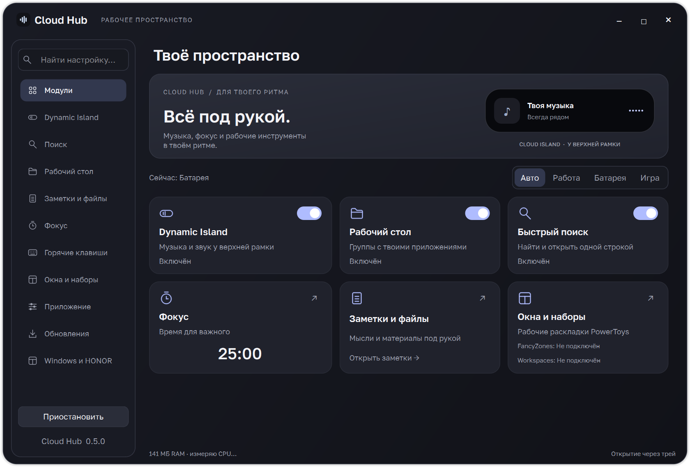
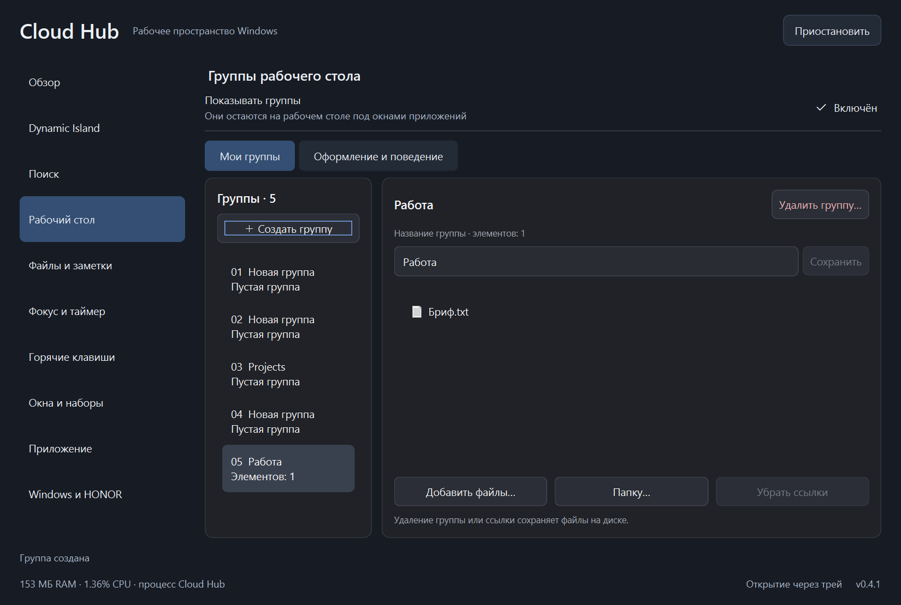
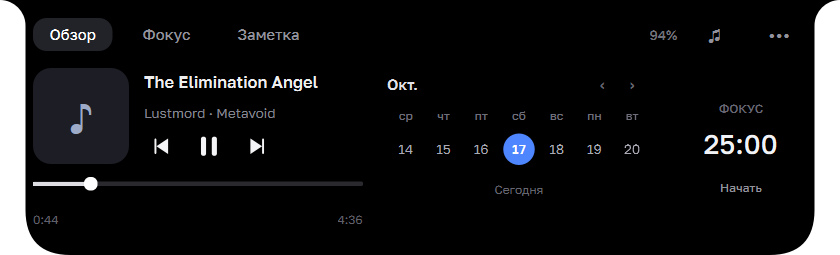

# Nelviro · Нелвиро

> **Активная линия: 0.8.0, бесплатная community-сборка на PySide6.**
> Направление изменено: бесплатный открытый проект, Telegram-сообщество и добровольная поддержка.
> Базовые функции работают без входа. Подписка на @Nelviro открывает дополнительные группы.
> Публичный сервис подключения работает на Vercel; база — PostgreSQL на бесплатном плане Neon.
> Старые выпуски 0.5.1 и ранее сохраняют свои GPL-условия.
> Инструкции сборки и оставшиеся требования: [коммерческая база](docs/commercial-foundation.md),
> [проверка прав](legal/PROVENANCE.md). Описания версий ниже — история проекта.

Обновлённый интерфейс Nelviro: оригинальный знак N, графитовая и светлая темы,
живые предпросмотры модулей и единое оформление поиска и групп.
Правила оформления: [дизайн Nelviro](docs/NELVIRO_DESIGN.md).
Имена EXE и папки данных сохранены для совместимости обновлений.

Точный статус, ограничения, подключение и roadmap: [версия 0.7](docs/community-release-0.7.md).
Текущий код возвращён под GPL v3 по решению владельца; зависимости сохраняют
свои условия. Предыдущие публичные права остаются без изменений.

Прямое подключение Telegram описано в [server/COMMUNITY.md](server/COMMUNITY.md).
Яндекс ID и оплата не входят в действующий сценарий; продажи выключены.

Единый локальный центр модулей Windows: чёлка Cloud Island, рабочие профили,
пауза фоновых служб, собственный поиск, группы рабочего стола, заметки и таймер.
Центр открывается через ярлык **Cloud Hub**, значок в трее или **Ctrl+Alt+H**.



## Новый Cloud Hub 0.5

Центр получил спокойный интерфейс с единой типографикой, светлой, тёмной и
системной темами. Карточки на экране **Модули** дают быстрый доступ к инструментам,
переключатели работают сразу. Найти нужный раздел можно строкой над меню или
через **Ctrl+F**. Переходы и переключатели анимированы короткими движениями;
их можно отключить в **Приложение → Анимации интерфейса**.

В **Обновлениях** теперь можно скачать проверенный установщик и нажать
**Установить и перезапустить**. Cloud Hub сохранит данные, создаст резервную копию,
установит новую версию и откроется снова. Активный таймер учитывает время установки,
таймер на паузе сохраняет остаток. Для перехода с 0.4.2 и более старых версий
один раз установи последнюю версию 0.5 вручную; следующие обновления доступны из самого приложения.
В 0.5.1 добавлен файл канала релизов, чтобы проверка не зависела от анонимного лимита GitHub API.
Подробности и восстановление: [обновления](docs/updates.md).


## Ярлыки и прокрутка в 0.4.2

Группы теперь сохраняют собственные копии ярлыков `.lnk` и `.url`. После успешного
сохранения совпадающий ярлык убирается с рабочего стола — запуск больше не зависит
от значка на нём. Сами программы, документы и папки не перемещаются.
Существующие доступные ярлыки переносятся с резервной копией списка групп.

В **Рабочий стол → Оформление и поведение** можно выключить **Убирать добавленные
ярлыки с рабочего стола**. Правый щелчок по сохранённому ярлыку → **Скопировать ярлык
на рабочий стол** возвращает его значок. Удаление группы сохраняет ярлыки в библиотеке,
которую можно открыть с той же вкладки настроек.

Внутри групп иконки показываются без стрелок, с сохранением оригинальных изображений.
Колёсико прокручивает содержимое плавно, тачпад использует точное движение системы.
Описание хранения и реализации: [ярлыки и прокрутка](docs/shortcuts.md).

## Управление группами в 0.4.1

Открой **Рабочий стол → Мои группы**. Слева видны все группы с номерами и
количеством элементов, справа — название, файлы и действия для выбранной группы.
Название сохраняется кнопкой **Сохранить**, по Enter или при выходе из поля.
**Создать группу** сразу предлагает ввести название; **Удалить группу…** запрашивает
подтверждение. Файлы на диске сохраняются.

Меню **⋯** на самой группе теперь содержит **Переименовать…**, **Удалить эту группу…**
и **Настроить эту группу…**: последняя команда выбирает именно её в Cloud Hub,
даже когда названия совпадают. Размеры, прозрачность, задержки и закрепление
расположения вынесены на вкладку **Оформление и поведение**.



## Новое в 0.4

Поиск и группы получили общее спокойное оформление: единая поверхность,
крупнее текст, оригинальные линейные иконки, меньше рамок и декоративных слоёв.
В поиске убрана серая системная подложка Windows 11, которая не совпадала с
контуром нашего окна. Полупрозрачность включается отдельно; размытие фона не имитируется.

Свёрнутые группы компактнее раскрытых: заголовок автоматически занимает от
216 px, а внутри раскрывается сетка заданной ширины. Меню появляется при
наведении. Размер значков и подписи согласованы с сеткой, ссылки `.lnk`
показываются без расширения. Данные и исходные пути сохраняются.

Группы постоянно остаются на уровне рабочего стола под обычными окнами.
После сворачивания приложения они уже находятся на месте: скрытие и повторный
показ по активному окну удалены. Системная анимация «вылета» отключена только
для наших панелей. После перезапуска оболочки восстанавливаются их собственные
окна, без внедрения в Проводник. Профили «Игра», пауза и выключение модуля
по-прежнему останавливают группы.

Основания визуальных решений, ограничения материалов и источники описаны в
[заметке о дизайне](docs/design.md).

## Новое в 0.3.2

Фон и содержимое чёлки раскрываются одним движением: элементы масштабируются
вместе с формой и обрезаются по её контуру. Быстрое изменение направления
сохраняет скорость анимации. После раскрытия работают обычные интерактивные элементы.

Группы получили плавное раскрытие без пересборки сетки на каждом кадре,
компактное пустое состояние и более спокойное оформление. Меню располагаются
над панелями, выбор файлов не скрывает группу. Панели не становятся окнами
«поверх всех» и не мешают обычным приложениям.

Совпадающие позиции групп исправляются автоматически; исходное расположение
сохраняется в `desktop-groups.before-arrange.json`. Идентификаторы, названия и
ссылки сохраняются. Кнопка **Выровнять группы** доступна в меню и настройках.
Включи **Приложение → Запускать с Windows** для фонового запуска при входе;
повторный фоновый запуск не открывает настройки и не создаёт второй экземпляр.

## Новое в 0.3.1

Исправлено замирание спектра от батареи: он продолжает реагировать в свёрнутой
чёлке, с частотой обработки 20 Гц вместо 40 Гц. Полное отключение от батареи
включается отдельной настройкой и по умолчанию выключено.

Цифры таймера редактируются щелчком и колесом: вводи минуты, Enter применяет,
Esc отменяет. По завершении звучит сигнал, раскрывается «Фокус» и появляется
кнопка «Остановить». Длительность сигнала и звук настраиваются. В профиле «Игра»
чёлка не открывается поверх игры, но звук и уведомление остаются.

Поиск получил компактную стеклянную панель, адаптивную высоту, аккуратные строки
результатов и скрытые полосы прокрутки. Материал Windows 11 запрашивается там,
где поддерживается; запасное оформление не требует захвата экрана.

## Новое в 0.3

Настройки разделены на обзор, Dynamic Island, поиск, рабочий стол, файлы и
заметки, фокус, горячие клавиши, окна и наборы, приложение и Windows/HONOR.
Размеры свёрнутой и раскрытой чёлки, прозрачность, задержки и состав обзора
настраиваются сразу, с живым результатом.

В компактном обзоре слева находится мини-плеер с обложкой, по центру — семь
дней с сегодняшним днём в центре, справа — небольшой таймер. Календарь листается
колёсиком, обеими осями тачпада и перетаскиванием; нажатие на месяц возвращает
сегодняшний день. Это локальный календарь дат, без подключения событий аккаунтов.

**Поиск Cloud Hub**: Alt+Space, приложения из «Пуска» (включая Store), команды,
полный путь и имена файлов из индекса Windows. Собственного обхода всего диска
нет: неиндексированные папки не участвуют в поиске по имени. Запросы выполняются
по необходимости, вне потока интерфейса. При недоступном индексе приложения и
команды работают. Подключение PowerToys не требуется.

**Группы рабочего стола** раскрываются при наведении. Добавь ссылки на ярлыки,
файлы и папки в разделе «Рабочий стол» или перетаскиванием; перемести панель за
заголовок. Двойной щелчок открывает элемент, Escape сворачивает группу. Можно
менять ширину, число столбцов, прозрачность, задержки и закреплять расположение.
Окна приложений перекрывают группы, которые остаются на рабочем столе. Документы
и папки остаются на своих местах; для ярлыков создаются независимые копии в Cloud Hub.
Ранее установленные сторонние организаторы рабочего стола не импортируются.

**Заметки**: быстрая общая заметка в чёлке и Hub, отдельные именованные заметки,
поиск по названию и тексту, автосохранение, копирование и экспорт TXT. **Таймер**:
любое число минут от 1 до 1440, пауза/продолжение и уведомление по завершении.
Полка файлов в чёлке по умолчанию выключена; она доступна как дополнительный
промежуточный список для перетаскивания файлов между приложениями.

Горячие клавиши изменяются в своём разделе. По умолчанию: **Alt+Space** — поиск,
**Ctrl+Alt+I** — чёлка, **Ctrl+Alt+H** — Cloud Hub. При конфликте сохраняется
прежнее рабочее сочетание. Любую клавишу можно отключить.

## Профили и модули

- **Автоматически** — «Работа» от сети, «Батарея» при отключении зарядки.
- **Работа** — выбранные модули и живой спектр.
- **Батарея** — живой спектр работает и в свёрнутой чёлке с меньшей частотой обработки. Полное отключение — отдельная опция.
- **Игра** — чёлка, захват звука и опрос медиасессий остановлены. Включается вручную.
- **Приостановить** — временная пауза модулей; индивидуальные переключатели сохраняются.

Отдельно установленный [PowerToys](https://learn.microsoft.com/windows/powertoys/install)
подключается кнопкой в центре. Cloud Hub управляет флагами CmdPal, FancyZones и
Workspaces. Перед подключением сохраняется исходное состояние этих трёх модулей.
Изменения применяются через официальный DSC с полной конфигурацией; для их
применения PowerToys штатно завершается и запускается снова. Его окно настроек
при этом закрывается. Для совместимости с сериализатором DSC 0.101 сохраняется
точная исходная JSON-конфигурация: после DSC, пока PowerToys закрыт, атомарно
восстанавливаются посторонние поля и исходные имена ключей. При выходе из Cloud Hub или отключении интеграции исходные
три флага восстанавливаются. Пока соединение активно, CmdPal выключен: поиск
предоставляет Cloud Hub. Другие утилиты, автозапуск и оформление PowerToys
сохраняются. Подключение требует PowerToys с DSC (проверено на 0.101.2362.0).

Во вкладке **Рабочие наборы** открой редактор Workspaces, сохрани нужные приложения
и положение окон, затем запусти набор из списка Cloud Hub. Редактор FancyZones
настраивает зоны окон. Сами наборы создаёт и хранит PowerToys; Cloud Hub читает
список и вызывает его launcher, не изменяя внутренние файлы конфигурации.

Управление питанием/драйверами HONOR остаётся в PC Manager. Cloud Hub открывает
штатные страницы Windows и не меняет схему питания, частоту экрана или параметры
TranslucentTB. Глубокая стилизация «Пуска» и микшер отдельных приложений в 0.3
не входят. TranslucentTB и Windhawk Taskbar Styler нельзя использовать одновременно.

Счётчик нагрузки в центре показывает текущий процесс Cloud Hub, включая чёлку,
без процессов PowerToys и загрузчика PyInstaller. На скрытой странице счётчик
не обновляется. Короткий замер не является тестом автономности. Запущенный
пользователем таймер продолжает отсчёт и при скрытой чёлке.

## Cloud Island

Минималистичный остров у верхней рамки Windows. Мягко огибает курсор,
показывает настоящий спектр звука и раскрывает управление музыкой, календарь,
таймер, заметки и файловую полку.

[**Скачать для Windows**](https://github.com/BochkaPiva/dinamic_island_windows/releases/latest)
· [Сообщить об ошибке](https://github.com/BochkaPiva/dinamic_island_windows/issues/new/choose)
· [Сборки и проверки](https://github.com/BochkaPiva/dinamic_island_windows/actions)



## Установка

Windows 10/11, x64. Для предварительной 0.6 используй проверенный частный
`CloudIsland-Setup-X.Y.Z-win-x64.exe`; публичный latest относится к старой GPL-линии.
Установка выполняется для текущего пользователя, без прав
администратора. Python и библиотеки отдельно не нужны.

Имя EXE, путь установки и идентификатор установщика сохранены от Cloud Island,
чтобы обновления 0.1.x сохраняли заметки, настройки и файловую полку.

Для переносного варианта распакуй `CloudHub-X.Y.Z-preview-win-x64.zip` в отдельную
папку и запусти `CloudIsland.exe`. Сохраняй рядом `_internal` и лицензии:
один EXE без этих файлов не запускается. Релизы пока
не имеют сертификата подписи кода.

## Как пользоваться

| Действие | Управление |
| --- | --- |
| Открыть на рабочем столе | Навести курсор или нажать на остров |
| Открыть поверх приложения | Коснуться верхнего края в центре и задержаться около 90 мс |
| Добраться до вкладок под островом | Подвести курсор: форма уйдёт вверх, ввод пройдёт в нижнее окно |
| Свернуть | Увести курсор; Escape при фокусе в панели |
| Громкость Windows | Колесо над островом |
| Выбрать плеер | Кнопка ♫ в раскрытой панели |
| Полка файлов | Раздел «Файлы и заметки»; опционально — вкладка «Полка» в чёлке |
| Убрать файл с полки | Delete — удаляется только ссылка |
| Экран, автозапуск, обновления, выход | Правый щелчок или значок в трее |

Остров закреплён в центре выбранного экрана и не перетаскивается. Системные
медиасессии предоставляются самим плеером: доступность обложки, перемотки и
кнопок зависит от приложения. Сам остров не воспроизводит и не скачивает музыку.

Спектр анализирует выходной микс Windows, включая видео и игры. Микрофон не
используется, аудиозаписи не сохраняются. В тишине полосы затухают.

Громкость следует движению вверх/вниз, а не направлению прокрутки содержимого:
вверх — громче, вниз — тише. Для Precision Touchpad учитывается настройка Windows.
Если старый драйвер выдаёт жесты как обычную мышь без данных об источнике, в меню
доступно «Обратить громкость при прокрутке». Эта настройка меняет только остров.


## Обновления и данные

Проверка стабильного релиза выполняется при запуске и затем раз в сутки,
если включена в настройках. При наличии новой версии появляется уведомление.
Открой **Обновления → Скачать обновление**: загрузка идёт в фоне с отображением
прогресса и возможностью отмены. После проверки SHA-256 становится доступна
кнопка **Установить и перезапустить**. Установка не требует прав администратора.
Файлы настроек, заметок, групп и полки сохраняются в `%LOCALAPPDATA%\Cloud Island`;
обновление и удаление программы их не стирают. Автозапуск включается отдельно.

Перед установкой сохраняются резервная копия данных и предыдущий EXE в
`%LOCALAPPDATA%\Cloud Island\backups`. После установки запускается проверка Qt/WinRT
и новая версия открывает страницу с результатом. Если установщик или проверка
завершились ошибкой, помощник пытается восстановить предыдущий EXE и запуск.
Полная копия данных остаётся доступной. Переносной EXE при таком обновлении
переходит на стандартную установку текущего пользователя с теми же данными.
Повторно установить текущую версию можно кнопкой **Восстановить установку**.

Исходники, `SHA256SUMS.txt`, установщик и переносной архив публикуются вместе.
Программа не скачивает и не запускает обновления без действия пользователя.
Старые личные данные Glassy Music Widget автоматически не импортируются.

## Разработка

Текущая проверенная среда сборки: Windows x64, CPython 3.14.

```powershell
# Выполняй из частной рабочей копии cloud-hub-commercial, не из публичной GPL-линии.
python -m venv .venv
.\.venv\Scripts\Activate.ps1
python -m pip install --only-binary=:all: -r requirements-dev.txt
python main.py
```

```powershell
python -m unittest discover -s tests -v
python tools/check_native.py build/native-check
python tools/check_workspace.py build/workspace-check
winget install --id JRSoftware.InnoSetup --exact --source winget
powershell -ExecutionPolicy Bypass -File packaging/build.ps1
```

Готовые файлы: `dist/release`. Для сборки без установщика доступен
`packaging/build.ps1 -SkipInstaller`. Диагностика собранного EXE:

```powershell
.\dist\CloudIsland\CloudIsland.exe --self-test build/runtime.json
.\dist\CloudIsland\CloudIsland.exe --audio-self-test build/audio.json
.\dist\CloudIsland\CloudIsland.exe --diagnostics build/runtime-state.json
```

Тест мыши использует собственное нижнее окно с кнопкой вкладки, без
автоматизации чужих браузеров. Проверка аудио требует реального выходного
устройства; отсутствие устройства не мешает сборке в CI.

## Участие и выпуск версий

Инструкции для изменений и релизов: [CONTRIBUTING.md](CONTRIBUTING.md).
Архитектура модулей: [ARCHITECTURE.md](docs/ARCHITECTURE.md).
Вопросы безопасности: [SECURITY.md](SECURITY.md). Ошибки и предложения принимаются
через Issues; наличие репозитория не означает круглосуточной поддержки.

## Происхождение и лицензия

Публичная линия 0.5.1 — GPL-3.0-only. Эта частная 0.6 является кандидатом
коммерческого преемника, со смешанными унаследованными и новыми файлами до
завершения проверки прав: [LICENSE](LICENSE), [PROVENANCE](legal/PROVENANCE.md).
Создана после личного прототипа на базе Glassy Music Widget; исходный код,
иконка и файлы переводов того приложения в этой версии не распространяются.
Наши заново написанные модули интерфейса, волны и анализа звука сохранены.
Зависимости и свободный шрифт Golos Text перечислены в [THIRD_PARTY.md](THIRD_PARTY.md).
