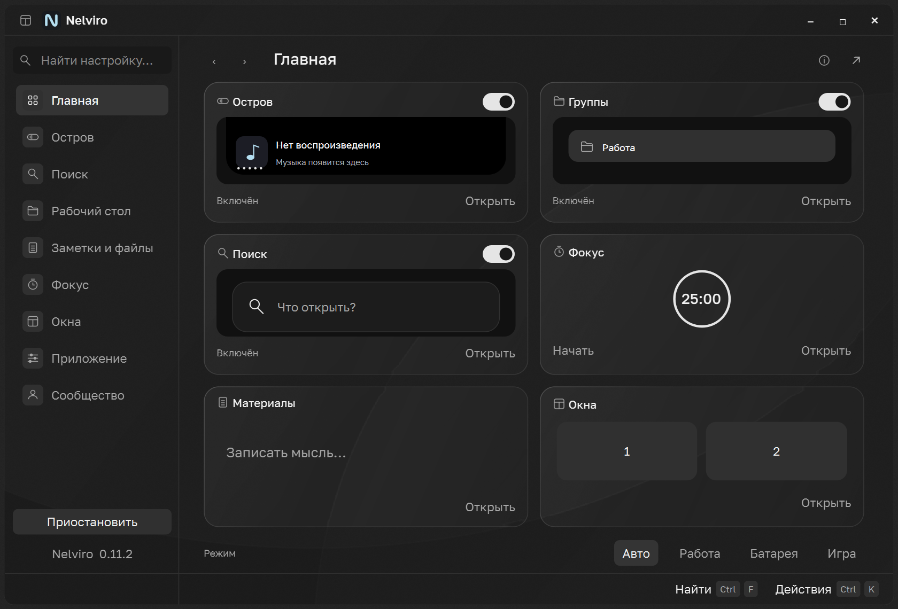
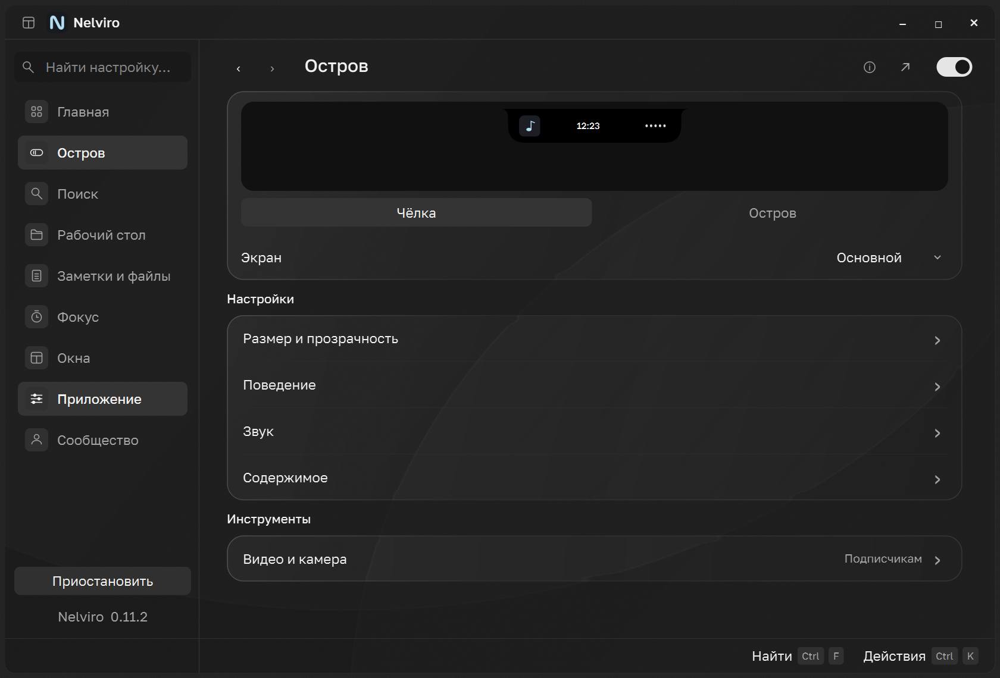
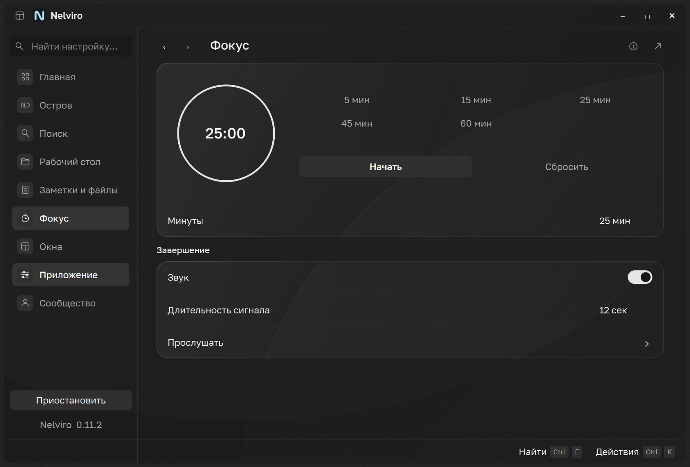
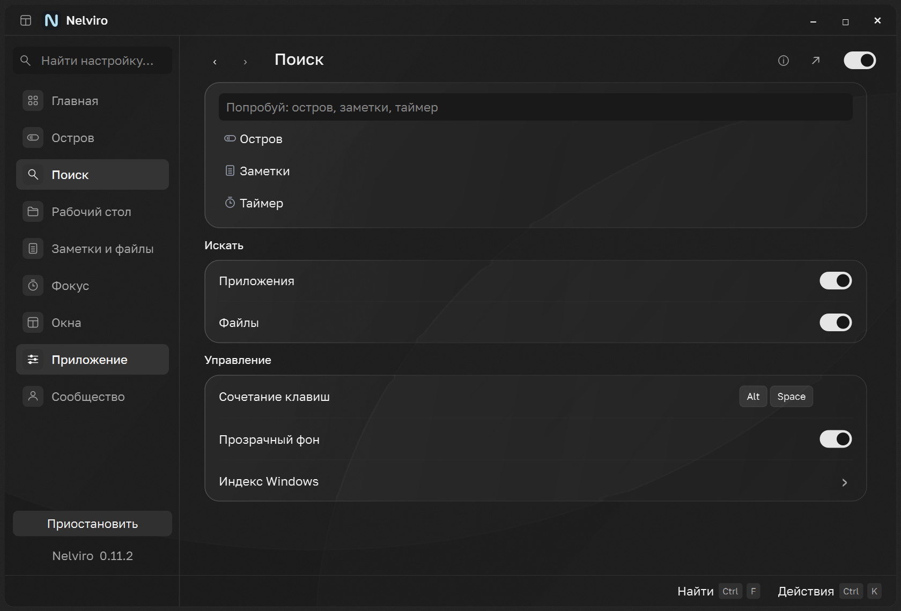
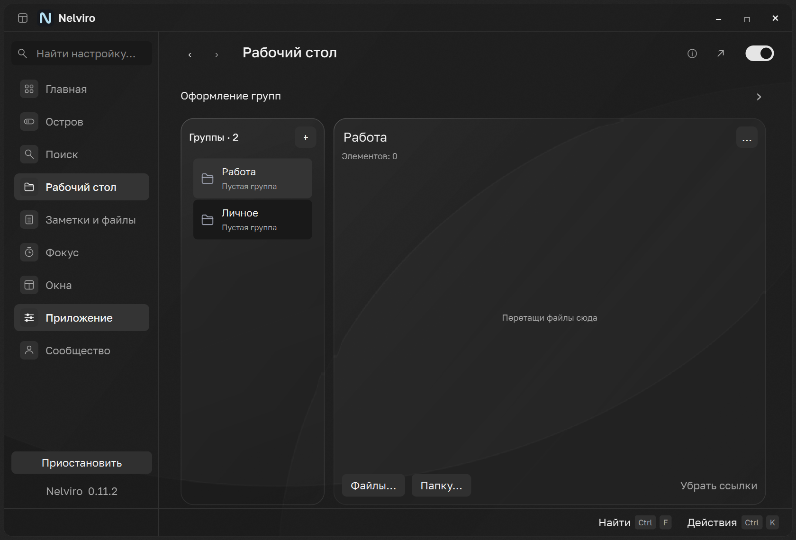
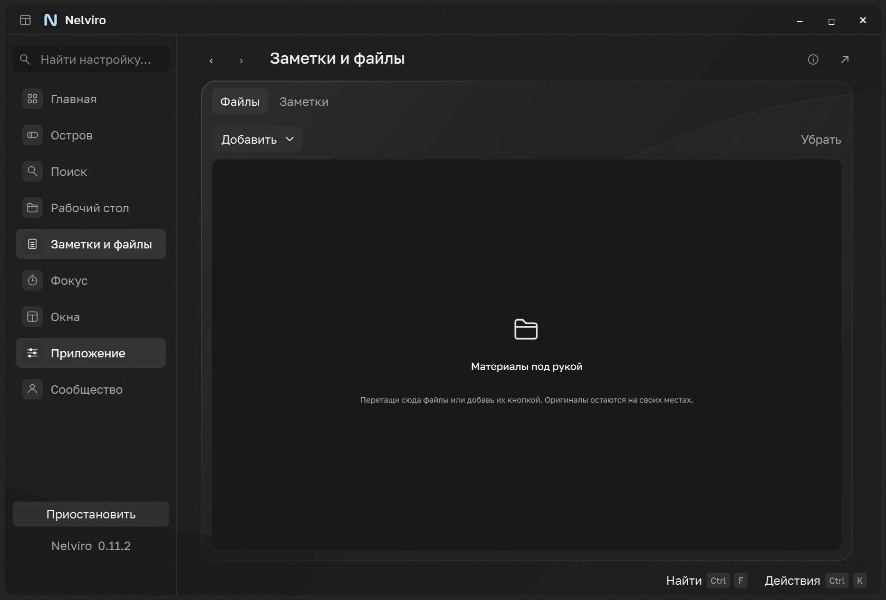
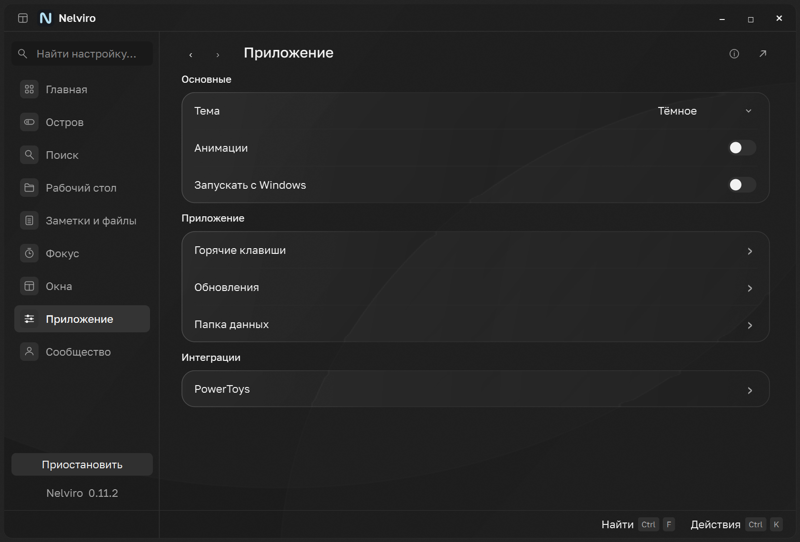
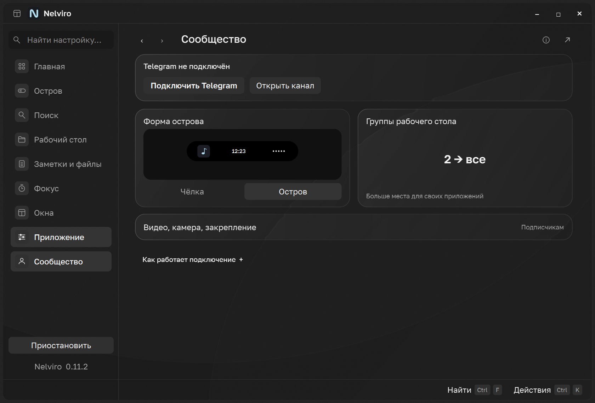

# Nelviro 0.11.2 · interactive home and optical surfaces

## Current interface

Home uses six interactive tiles over the existing shared models: media, groups,
search, focus, notes and window zones. Start/pause and timer editing work directly
in the tile; typing in the search demonstration filters three actual app commands.
Detailed search remains the separate existing launcher. The visible dashboard clock
updates independently of tile hover, and audio coalescing stops when the page hides.

Island has direct form buttons with one effective-access preview; the saved member
choice survives free access. Focus combines the centered ring, presets in a three-
column grid and start/reset, followed by completion settings on the same page.
Groups and materials use common pane surfaces. Community has persistent connection
controls, an interactive form comparison and a compact group/media benefits view.
Shortcuts and Updates remain reachable via Application/search; stable root IDs and
history are unchanged. Bottom key hints remain visible.

The neutral optical layer samples only the app-owned light field in a 12 px rim.
It displaces those pixels, then paints controls/labels sharply above them. External
desktop blur is native Windows acrylic, not desktop refraction. No screen capture,
wallpaper image, web dependency or continuously running optical animation was added.
Native failure/disabled transparency/high contrast retain opaque surfaces.

Frontend Design and UI UX Pro Max are advisory; the user's references and PySide6
architecture remain authoritative. No Raycast assets/code were copied.

## Preservation and scenario map

| Task | Current entry / flow | Preserved behavior |
| --- | --- | --- |
| Enable modules | Home tiles and header master switches | Same stored preferences and runtime policy |
| Select profile / pause | Home mode controls; sidebar pause | Policy does not overwrite preferences |
| Notch/floating | Island → form buttons, one live preview | Floating gated by channel access, saved choice retained |
| Monitor | Island → Screen | Existing monitor identity and positioning |
| Dimensions / opacity / gap | Island → Size and opacity | All six typed values and existing limits |
| Cursor / fullscreen / delays | Island → Behavior | Same reversible presentation/geometry logic |
| Spectrum / battery | Island → Sound | Existing loopback, no microphone/new audio service |
| Calendar / focus / shelf | Island → Content | Same actual models and features |
| Local video / camera / pin | Island → Video and camera | Existing member checks; no browser-stream claim |
| Search sources / glass / hotkey | Search primary screen | Existing Windows index, bounded workers and generation guards |
| Group create/select/name | Desktop list and inline name | Stable IDs, draft protection and validation |
| Group delete/activate | Selected group `…` menu | Confirmation, original files retained, access limits |
| Files/folders in group | Add buttons or drag/drop | Owned shortcut library and existing collection behavior |
| Group appearance / delays | Desktop → Group appearance | Same values, desktop owner/layer recovery unchanged |
| File shelf / notes | Files and Notes tabs | Shared quick note, atomic/debounced save and update flush |
| Focus timer | Timer, presets and start/reset | Monotonic countdown, wheel/direct entry, pause/resume |
| Alarm | Focus primary completion group | Same WAV, bounded alarm, mute/dismiss |
| Window sizing | Windows → Layout | Existing verified native HWND placement |
| Saved workspaces / zones | Windows detail screens | Existing optional PowerToys integration and backups |
| Global hotkeys | Shortcuts; Search shortcut row | RegisterHotKey conflicts/rollback, canonical key model |
| Theme / motion / autostart | Application primary screen | Same settings, dark/light/system and reduced motion |
| PowerToys connect/restore | Application → PowerToys | Existing backup and restore behavior |
| Updates | Application entry / settings search | Check/download/verify/install/cancel/recovery unchanged |
| Telegram | Community status/action/comparison | Persistent widget tree, original pairing and signed permits |
| Find a setting | Settings search → matching control | Exact page names win; detail and focus restored |
| History | Back/forward, Alt+Left/Right, Escape | Persistent bodies, root IDs/deep links preserved |

No technical install/data/IPC identities, keys, service URLs, file formats or capability
rules were changed. All 15 prior numeric controls and 22 toggles remain represented.

## Verification

- 226 desktop unit/regression tests pass and cover shared timers, preset bounds, command filtering,
  retained settings, history, data/access contracts, and exact optical pixel sampling.
- Native root/detail matrix covers 240 cases: two themes, widths 900/1120, actual DPR 1/1.5/2.
  Results are generated in build/studio-final-matrix; no horizontal overflow or Qt errors.
- Native group management checks preserve originals, group IDs and safe dialog actions.
- Native shortcut checks cover cancel/save/conflicts and composed material.
- Native launcher checks cover popup retention, settings navigation and five commands.
- Scroll CPU check at DPR 2: approximately 16 ms median / 18 ms p95 across 32 owned-fixture steps. This does not measure compositor FPS.
- Packaged candidate build, self-test and dependency/license audit are recorded on PR #6.

## Actual Windows captures

These are complete windows rendered by the app in an isolated fixture profile,
not generated mockups or product screenshot backdrops.

