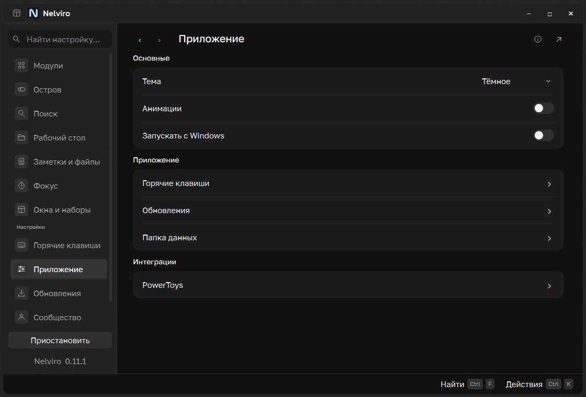
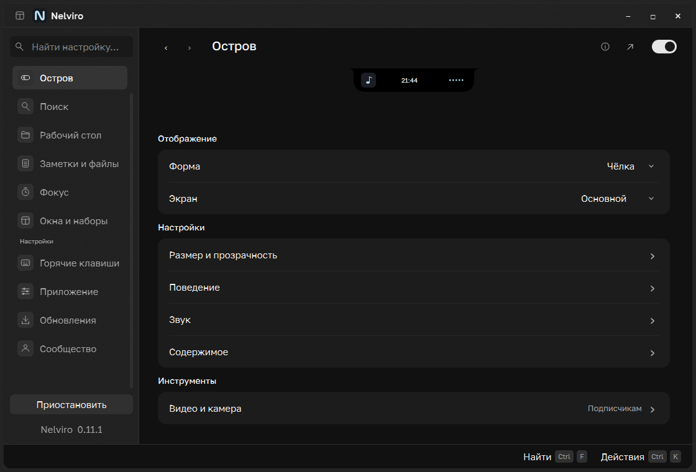
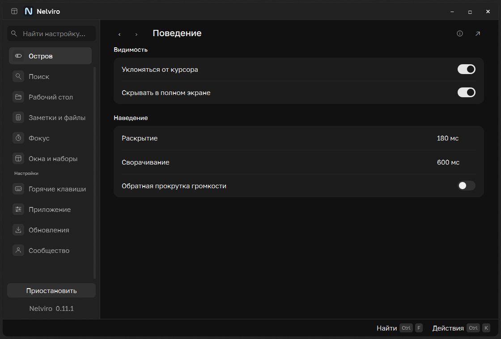
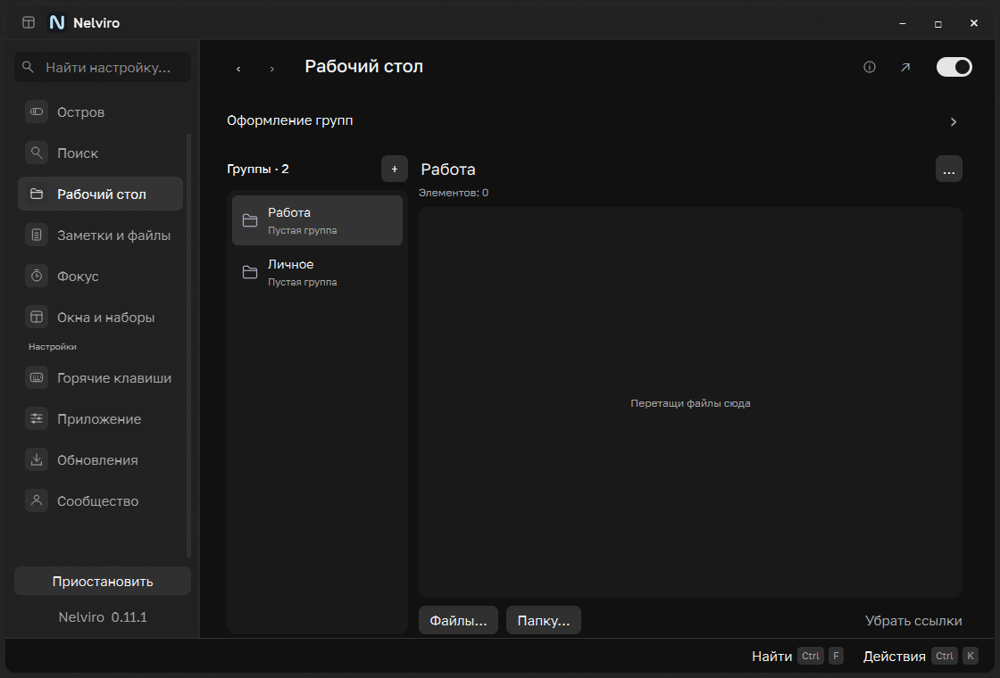
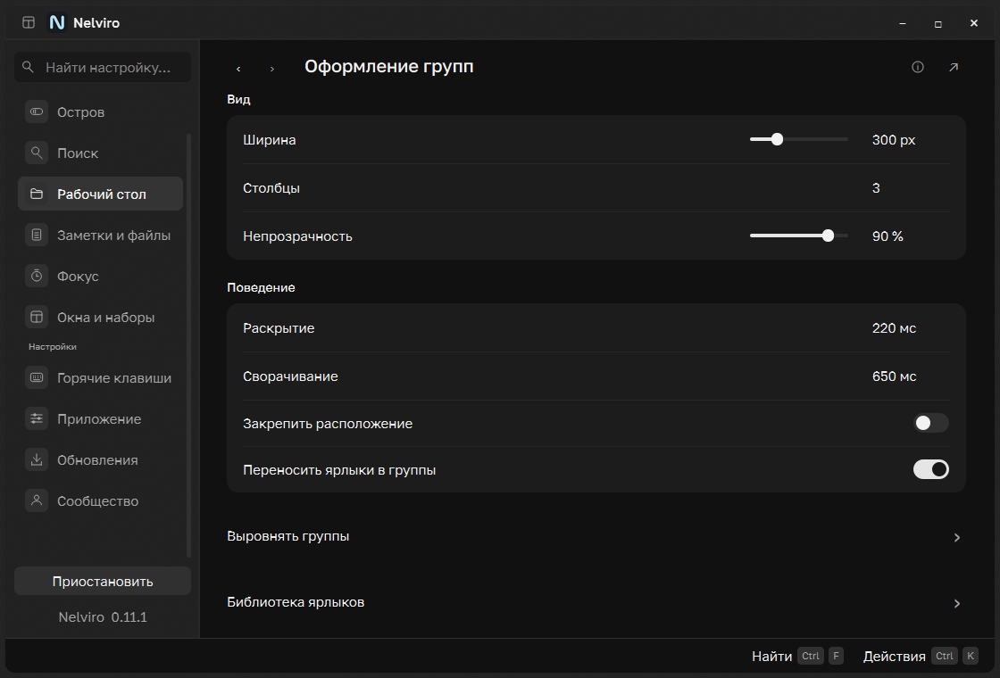
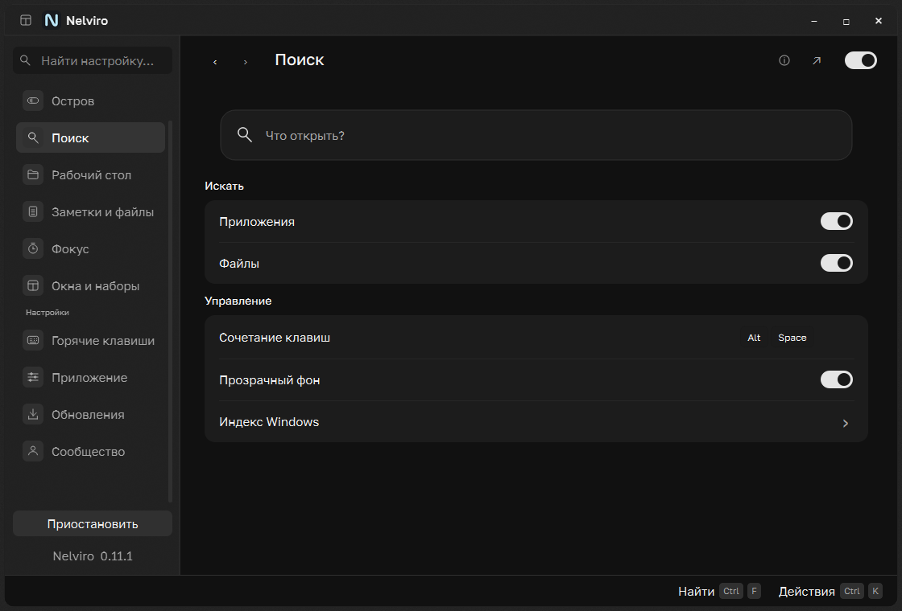
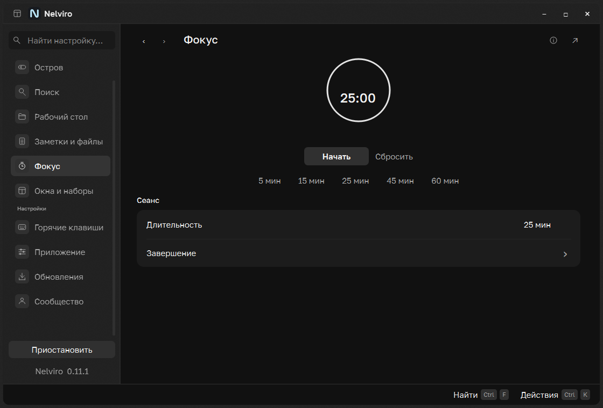
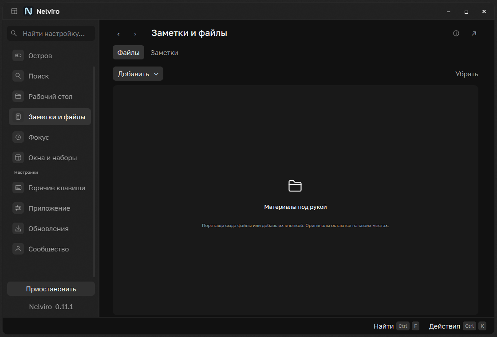
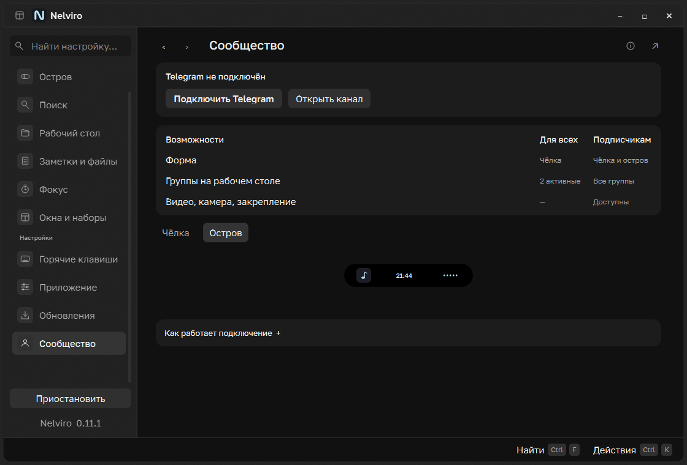
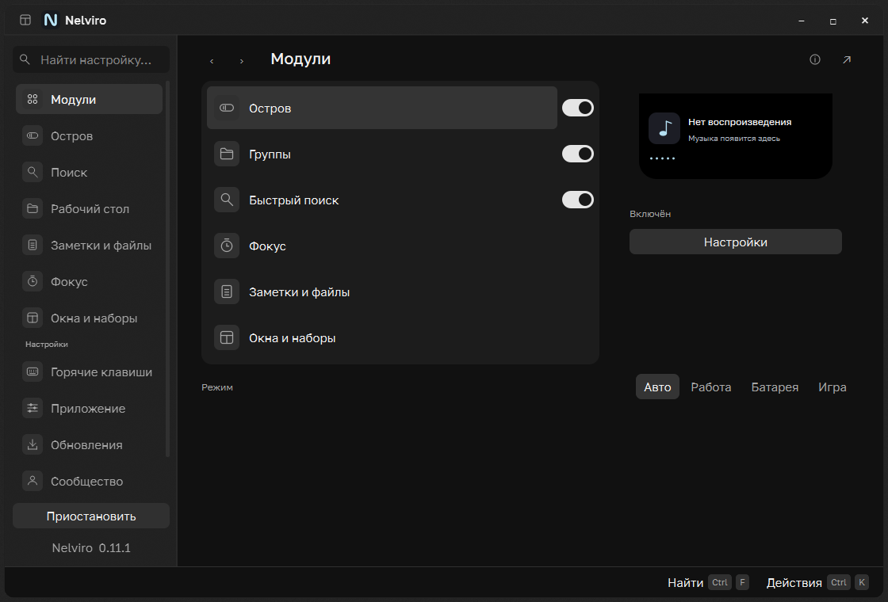

# Nelviro 0.11.1 · navigation and visual redesign

## Problem and result

The 0.11.0 pass retained long explanatory copy, repeated labels and a flattened
hierarchy. The user rejected it and supplied Raycast Settings again. This pass changes
composition and the paths through settings, rather than treating a color change or a
binding dialog as completion. Root screens are short, related settings use common
rows, and detailed tasks open a separate screen with working history.

Frontend Design was installed from anthropics/claude-code and read alongside the
existing UI UX Pro Max. The user's references and existing Qt architecture remain
authoritative. No Raycast code/assets were copied; no web stack or backend was added.

## Preservation and scenario map

| Task | Current entry / flow | Preserved behavior |
| --- | --- | --- |
| Enable modules | Catalog and header master switches | Same stored preferences and runtime policy |
| Select profile / pause | Modules mode controls; sidebar pause | Policy does not overwrite preferences |
| Notch/floating | Island → Form, one live preview | Floating gated by channel access, saved choice retained |
| Monitor | Island → Screen | Existing monitor identity and positioning |
| Dimensions / opacity / gap | Island → Size and opacity | All six typed values and existing limits |
| Cursor / fullscreen / delays | Island → Behavior | Same reversible presentation/geometry logic |
| Spectrum / battery | Island → Sound | Existing loopback, no microphone/new audio service |
| Calendar / focus / shelf | Island → Content | Same actual models and features |
| Local video / camera / pin | Island → Video and camera | Existing member checks; no browser-stream claim |
| Search sources / glass / hotkey | Search primary screen | Existing Windows index, bounded workers and generation guards |
| Group create/select/name | Desktop list and inline name | Stable IDs, draft protection and validation |
| Group delete/activate | Selected group `…` menu | Confirmation, original files retained, access limits |
| Files/folders in group | Add buttons or drag/drop | Owned shortcut library and existing collection behavior |
| Group appearance / delays | Desktop → Group appearance | Same values, desktop owner/layer recovery unchanged |
| File shelf / notes | Files and Notes tabs | Shared quick note, atomic/debounced save and update flush |
| Focus timer | Timer, presets and start/reset | Monotonic countdown, wheel/direct entry, pause/resume |
| Alarm | Focus → Completion | Same WAV, bounded alarm, mute/dismiss |
| Window sizing | Windows → Layout | Existing verified native HWND placement |
| Saved workspaces / zones | Windows detail screens | Existing optional PowerToys integration and backups |
| Global hotkeys | Shortcuts; Search shortcut row | RegisterHotKey conflicts/rollback, canonical key model |
| Theme / motion / autostart | Application primary screen | Same settings, dark/light/system and reduced motion |
| PowerToys connect/restore | Application → PowerToys | Existing backup and restore behavior |
| Updates | Existing root and Application entry | Check/download/verify/install/cancel/recovery unchanged |
| Telegram | Community status/action/comparison | Persistent widget tree, original pairing and signed permits |
| Find a setting | Settings search → matching control | Exact page names win; detail and focus restored |
| History | Back/forward, Alt+Left/Right, Escape | Persistent bodies, root IDs/deep links preserved |

No technical install/data/IPC identities, keys, service URLs, file formats or capability
rules were changed. All 15 prior numeric controls and 22 toggles remain represented.

## Verification

- 221 desktop tests pass. New tests cover nested routes, history, actual setting search,
  page-name precedence, shared header switches and the complete prior control set.
- Native matrix: 11 roots + 10 details, two themes, widths 900/1120, actual DPR 1/1.5/2:
  252 rendered cases. No horizontal overflow or captured Qt exception. Isolated group
  files retain their bytes; hidden preview clocks stop.
- Native group checks: five identical-name fixture groups, ID-bound rename, create,
  desktop popup dispatch, cancel/delete confirmation, original retention, reload,
  small-window action access and separate appearance screen pass. That management
  fixture explicitly uses preview access; signed-permit/free-limit tests remain separate.
- Native shortcut checks: cancel preserves, save persists, conflict preserves old value;
  optional dark acrylic active on the test machine. Search-row recorder anchors to its
  actual clicked control. Opaque fallback remains covered.
- Native launcher checks: real popup retention, settings navigation, five empty-query
  commands and optional acrylic pass. No Windows/browser media behaviour changed here.
- Packaging result and Windows CI are recorded on PR #6 after the build completes.

## Actual complete windows

Composed Windows captures below use owned Qt fixture windows and a neutral backing;
they are application renders, not image mockups or runtime screenshot backgrounds.

The full dark/light/DPI root/detail matrix stays in build/minimal-final. The screenshots
show the implemented composition; they are not a claim of pixel-identical reproduction
or an excuse to consider any layout change sufficient without visual inspection.
