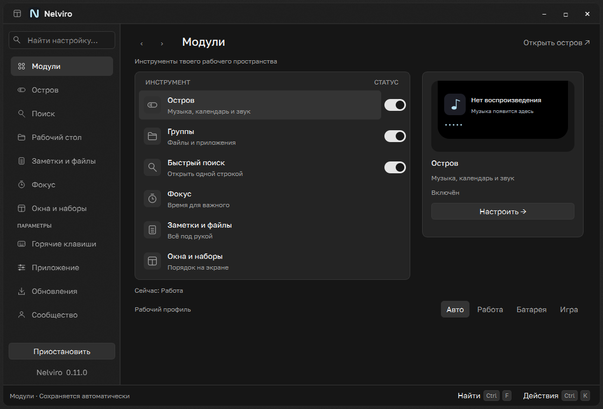
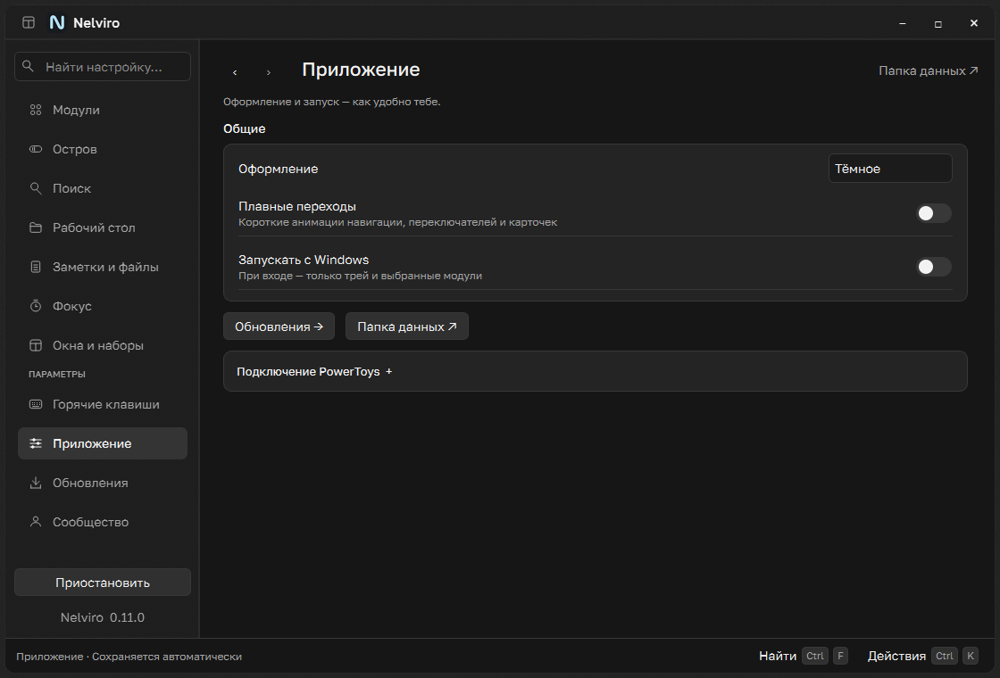
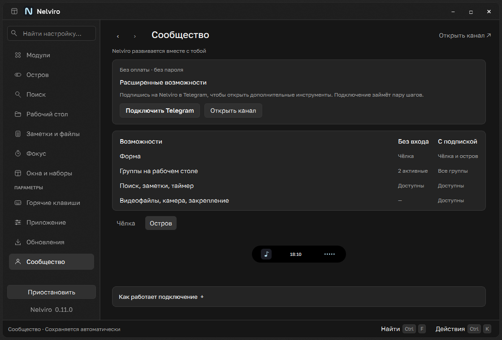
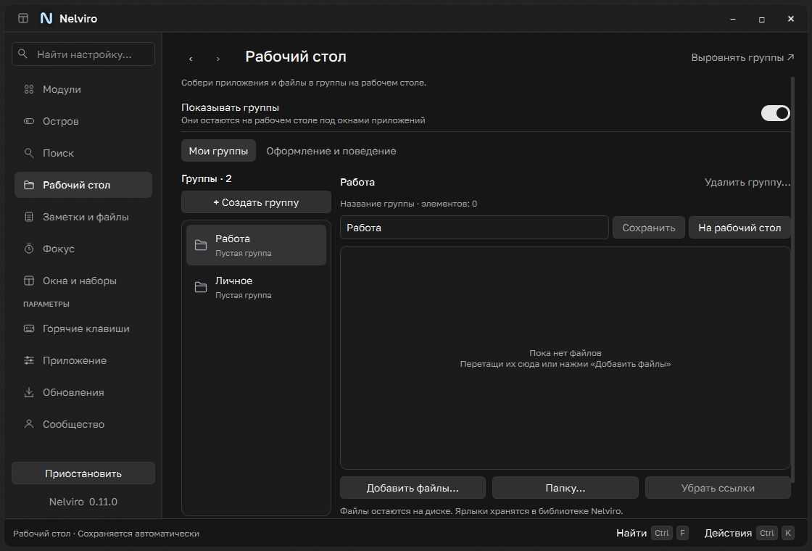
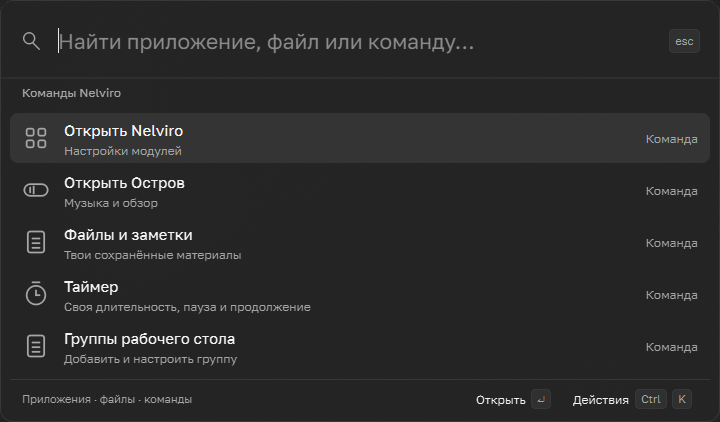

# Nelviro 0.11 · UX audit and preservation map

## Audit

Baseline is source version 0.10.2 (c64c33d), not obsolete releases. Read README,
architecture/design docs, brand, page factories, window shell, common widgets,
previews, settings storage, runtime policy, group editor, launcher and community.
The old dashboard had six large cards with competing previews and 256 logical px
of scroll at 1120×760. Page titles repeated inside headers; service settings used
the same prominence as daily tools. Group editor preview displaced useful controls.
A generic FileShelf empty painting overlapped GroupFiles' own empty label.

The approved final direction is the user's three Raycast reference screenshots
and subsequent explicit neutral black/gray clarification. This supersedes the
older Glacier UI selection requirement. UI UX Pro Max was used as advisory UX
input (keyboard navigation, hierarchy, progressive disclosure), not a stack or
brand replacement. No Raycast code, icons or imagery were copied.

## Structure and feature map

All sections remain directly reachable in the sidebar (icons when collapsed),
settings search, and stable programmatic page IDs. Catalog selection opens a
single inspector; its Configure action opens the actual module settings.

| Function | Before | Now / access | Preservation check |
| --- | --- | --- | --- |
| Module enables | Large module cards | Compact catalog switches; same module pages | Shared settings, disabled/game policy |
| Profiles, pause | Dashboard segments, sidebar | Dashboard footer; sidebar pause | Preferences never overwritten by policy |
| Media title, cover, transport | Island | Island, live selected inspector | Existing SMTC/audio models; no new capture |
| Real audio spectrum | Island behavior | Island → Behavior and sound | Loopback, no microphone; hidden previews stop |
| Notch/floating, gap | Two large cards | Island → Display, form picker, one preview | Floating still requires membership; saved choice retained |
| Cursor avoidance, fullscreen | Island controls | Island → Display / Behavior | Existing presentation state machine unchanged |
| Sizing, opacity, monitor | Island disclosures | Same disclosures | Same validated typed settings and ranges |
| Calendar, focus in overview | Island overview options | Island → What to show | Same seven-day calendar and timer |
| Local video, resume | Island media disclosure | Island → Video file and camera | Existing member checks, local player lifecycle |
| Camera mirror, pin | Island media disclosure | Same disclosure | Existing opt-in capture/cleanup; no mic |
| Search apps/files/commands | Search, launcher | Search sources; common launcher | Existing bounded async Windows index queries |
| Search appearance, hotkey | Search advanced | Search → Appearance / Shortcuts | Opaque fallback, reduced motion, Enter/Esc/arrow navigation |
| Search preview | Large header | Optional Preview search disclosure | Click launches real search |
| Group create/rename/delete | Group editor and panel menu | Desktop → My groups; same quick menus | ID-bound operations, draft preserved |
| Add files/folders, remove links | Group editor | Same editor, now above preview | Originals preserved; owned shortcut copies unchanged |
| Active-group selection | Group editor | Same On desktop action | Two free active groups, additional records retained |
| Group size/columns/opacity | Appearance tab | Desktop → Appearance and behavior | Same positions, bounds, shortcut library |
| Group drag/lock/recovery | Desktop panels | Same panels, quieter corners | Native desktop anchoring/recovery untouched |
| Notes, shelf files | Notes and files tabs | Same tabs without decorative header | Shared models, atomic save, flush before update |
| Focus, quick intervals, alarm | Focus and dashboard card | Focus; selected catalog inspector | Same monotonic timer, wheel/direct entry, sound/dismiss |
| Hotkey recorder/manual/off | Text inputs and action buttons | Keycaps → floating recorder; row menu for manual/off | Cancel/deactivate restores keys; atomic rebind/conflict rollback preserved |
| Native window placement | Windows and sets | Same page without decorative header | HWND/PID validation, min-size and size verification |
| PowerToys zones/workspaces | Page folds / Application | Same folds / Application → PowerToys | Existing backups/restore and optional bridge |
| Theme, animation, autostart | Application | Application → General | Dark/light/system, current registry identity |
| Updates/download/install | Updates | Parameters → Updates | Same verified update/helper/rollback/resume |
| Data directory, backups | Application / updater | Application links, unchanged backup mechanisms | No format or path migration |
| Telegram pair/confirm/refresh | Community hero | Community connection block | Same controller, signed device-bound permits |
| Grace/offline/expiry/reconnect | Community | Same persistent status/actions; compact comparison | Base tools remain; extra groups never deleted |
| Help/channel/disconnect | Community cards | Connection actions and help disclosure | No new payment or backend |

## Changes with functional implications

Only one dashboard preview is selected; focus controls are reached by selecting
Focus or opening its page. The old scroll test now exercises a genuinely long
expanded Island section instead of requiring the dashboard to overflow.
The focus refresh timer runs on the Focus page or selected Focus inspector only.
The group-specific empty state replaces, rather than overlays, the generic shelf
empty painting. No persisted settings, content, identities or protocols change.

## Verification

See build/raycast-neutral for the native Windows dark/light screenshots and JSON
reports at actual DPR 1, 1.5 and 2, logical widths 900/1120. Source screenshots
are rendered Qt widgets on isolated fixtures; they do not claim live subscription,
webcam hardware, browser metadata or elevated-window placement testing.
Before/after captures are in docs/screenshots/raycast. No user profile was edited.
Final regression/build results are recorded below after verification.

The later user feedback explicitly rejected flat text-field shortcut editing.
Shortcut rows now open an actual frosted recorder matching the supplied cropped
reference: individual keycaps, one Save action, Cancel/Escape and inline errors.
The neutral palette remains; real optional acrylic adds material to chrome and
transient panels. This is native composition with an opaque fallback, not a
screen capture effect. See the design document for compatibility details.

## Before and after (isolated Windows widgets, 1120 × 760)

| Section | 0.10.2 | 0.11 candidate |
| --- | --- | --- |
| Modules | [Before](screenshots/raycast/hub-before.png) | [After](screenshots/raycast/hub-after.png) |
| Island | [Before](screenshots/raycast/island-before.png) | [After](screenshots/raycast/island-after.png) |
| Groups | [Before](screenshots/raycast/desktop-before.png) | [After](screenshots/raycast/desktop-after.png) |
| Search settings | [Before](screenshots/raycast/search-before.png) | [After](screenshots/raycast/search-after.png) |
| Focus | [Before](screenshots/raycast/timer-before.png) | [After](screenshots/raycast/timer-after.png) |
| Community | [Before](screenshots/raycast/account-before.png) | [After](screenshots/raycast/account-after.png) |
| Application | [Before](screenshots/raycast/integrations-before.png) | [After](screenshots/raycast/integrations-after.png) |

[Native shortcut recorder](screenshots/raycast/shortcut-sheet-native.png) includes
Windows compositor output over the owned settings window, not a drawn glass mockup.
The page PNGs use Qt widget grabs: they intentionally exclude compositor backdrop
pixels and should not be used to evaluate blur. The native recorder image does.

## Verified candidate results

- 214 desktop regression tests pass. The seven shortcut-sheet tests cover save,
  cancellation/restoring bindings, duplicate preservation, invalid input without
  writes, disk failure rollback, Cyrillic physical letters and opaque fallback/Meta key round trip.
- Native Windows matrix: 132 page/theme/width/scale combinations; actual DPR
  1/1.5/2, widths 900/1120. No horizontal overflow or Qt exceptions. Hidden preview
  timers stop; isolated saved groups remain byte-identical.
- Community: 14 rendered state/theme combinations remain visible on repeated
  controller/access notifications. These are fixtures, not a new live unsubscribe test.
- Native calendar, timer, notes, search index, desktop-layer recovery and menu
  ordering checks pass (check_workspace.py, check_surfaces.py).
- Native recorder: acrylic is active on this Windows 11 host; save/cancel and
  conflicting combination checks pass. A checker/band fixture distinguishes native
  blur from alpha-only transparency and the opaque DWM transient backplate.
- Full PyInstaller/Inno build, packaged Qt/WinRT/Multimedia self-test and dependency
  license/bundle audit pass. The compiled EXE opens its settings window using an
  isolated, paused profile; both new UI modules are present in the frozen archive.
- Installed user data, autostart and production Telegram service were not changed.
  Live browser metadata, webcam hardware, third-party elevated windows and a fresh
  channel unsubscribe/rejoin cycle were not manually re-tested in this UI update.

The candidate is 0.11.0; it has not replaced the public update channel.

A 60-character group name without spaces is now elided while preserving full
accessible text and tooltip; it cannot widen the 900 px editor or push the desktop
menu out of the header. Native maximize/restore preserves the material contour.

## Follow-up: whole-screen composition and launcher

The user rejected spending further time on a single binding sheet. This pass changes
the shared window shell and complete-page composition: 218 px navigation, 40 px rows,
14 px body, external section labels, icon collection rows, bounded module catalog and
inspector, Community comparison surface, contextual header action, history, and a
working footer with Find / Actions key hints. The command palette now has grouped
results, default commands, a 720 px surface, real native acrylic with opaque fallback,
and actual selected-result actions. It does not add AI or claim browser video support.

Validation: 216 desktop tests passed; the final header/history adjustment also passed
all 16 hub interaction tests. Native page matrix passed at actual DPR 1/1.5/2,
widths 900/1120, both themes, without horizontal overflow or Qt exceptions. Isolated
group files retained their bytes and hidden previews stopped. Native launcher checks
passed empty-command suggestions, popup retention, navigation to Search Settings,
and optional material on this Windows machine. No production profile was modified.

Complete composed Windows screenshots (owned neutral backing window; not mockups):

